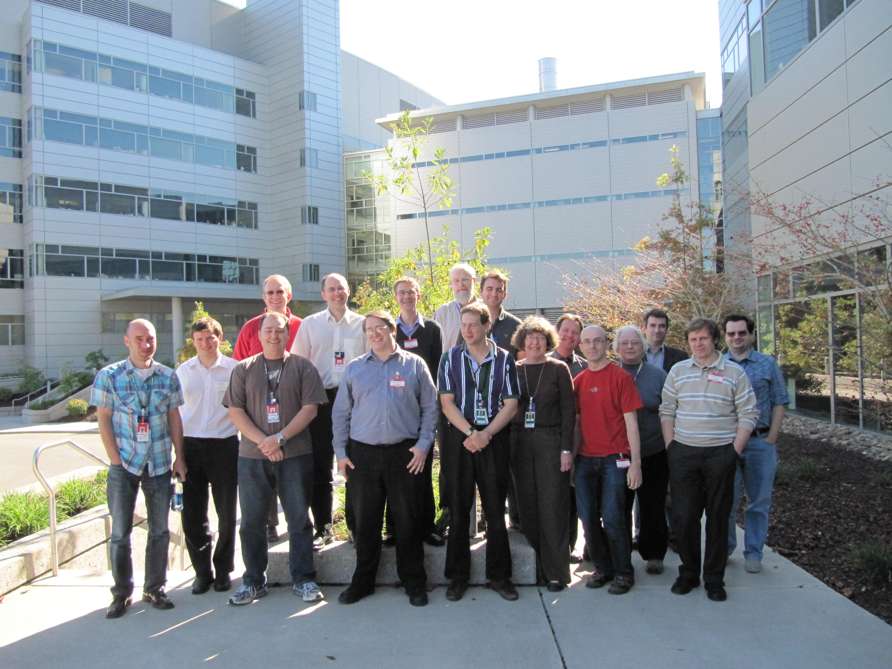
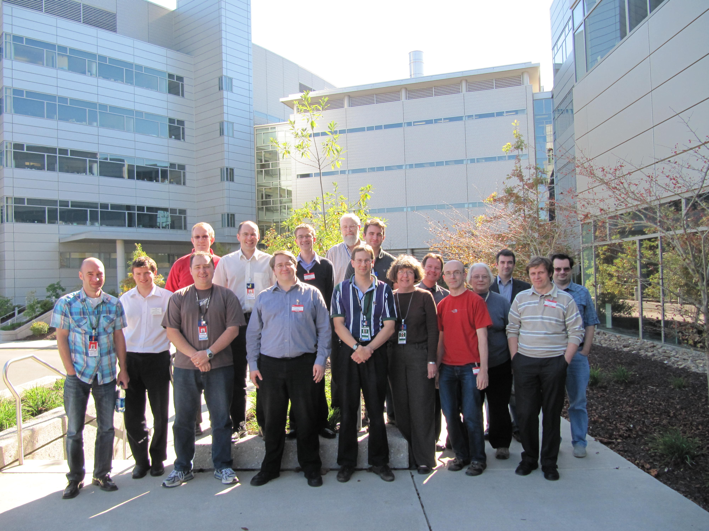
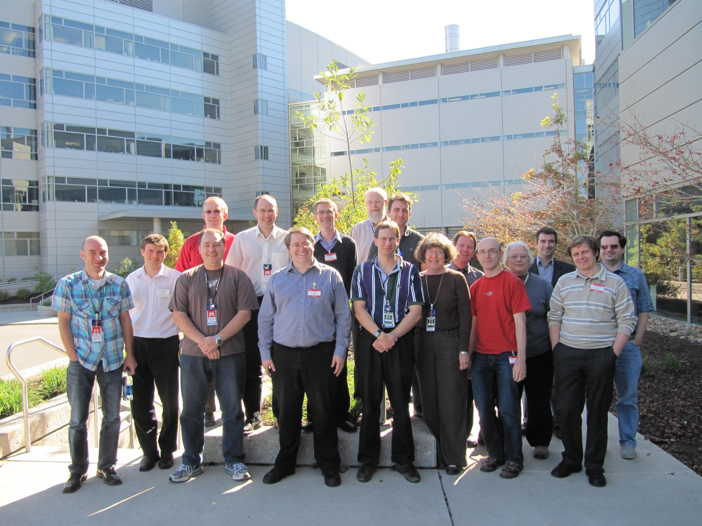
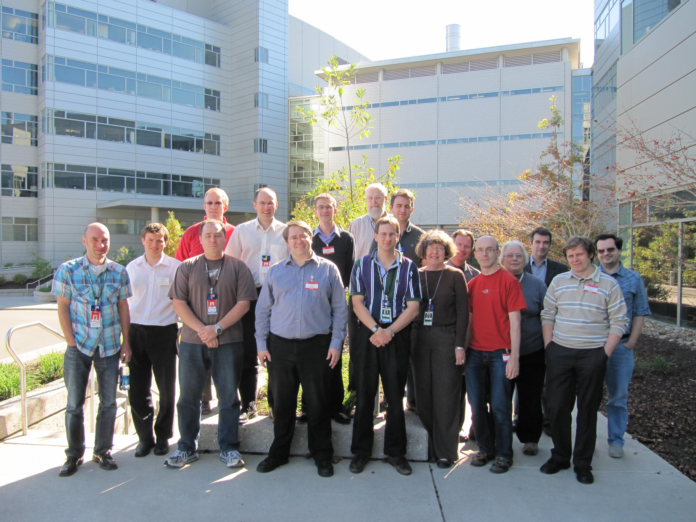

# Mantid Developer Workshop 2010

*Migrated from the retired Mantid wiki page `Category:Workshop2010`. Hotel and travel logistics were not carried over.*

## Agenda

### Thursday 14th October

| Time | Title | Chair |
| --- | --- | --- |
| 9:00 | Introduction | Nick Draper |
| 9:15 | Mantid Codebase Structure: What goes where | Nick Draper |
| 9:30 | Working with the Mantid Repository | Nick Draper |
| 9:45 | How to rollback a check in | Martyn Gigg |
| 10:00 | [OpenMP an introduction and how it is used in Mantid](https://developer.mantidproject.org/MultiThreadingInAlgorithms.html) | Russell Taylor |
| 10:30 | Break |  |
| 10:45 | Workspaces - Types and how to use them | Russell Taylor |
|  | How to create and access workspaces | Russell Taylor |
|  | [Matrix Workspaces](https://docs.mantidproject.org/nightly/concepts/MatrixWorkspace.html) | Russell Taylor |
|  | [Table Workspaces](https://docs.mantidproject.org/nightly/concepts/TableWorkspaces.html) | Roman Tolchenov |
|  | [Event Workspaces](https://docs.mantidproject.org/nightly/concepts/EventWorkspace.html) | Janik Zikovsky |
|  | Multi Dimensional Workspaces | Owen Arnold |
| 11:30 | Creating a Python API | Martyn Gigg |
| 12:30 | Lunch |  |
| 13:15 | QT, your first interface and working with layouts | Russell Taylor |
| 13:30 | User interfaces, custom user interfaces and widgets | Martyn Gigg |
| 14:00 | Coding - GetDetectorOffset |  |
| 15:15 | Break |  |
| 15:30 | Single Crystal & Diffuse Scattering Requirements and design ideas | Nick Draper |
| 16:00 | UB-Matrices, crystal orientation, etc | Laurent Chapon |
| 16:30 | Discussion: how does this fit into Mantid |  |
| 17:00 | Finish |  |

#### Evening

6.30pm boarding for 7pm sailing - Dinner, courtesy of Tessella, on the ['Star of Knoxville'](http://www.tnriverboat.com/).

9pm - Return. Docking is close to downtown Knoxville, where further entertainment such as [this](http://www.downtownbrewery.com/) is available.

### Friday 15th October

| Time | Title | Chair |
| --- | --- | --- |
| 9:00 | Geometry Introduction | Nick Draper |
| 9:30 | [Rendering the instrument view](https://developer.mantidproject.org/InstrumentViewer.html) | Roman Tolchenov |
| 10:00 | SANS Python Framework and HFIR SANS GUI | Mathieu Doucet |
| 10:30 | Break |  |
| 10:45 | Monte Carlo requirements Introduction | Russell Taylor |
| 11:00 | Monte Carlo Engine Preliminary high-level design | Martyn Gigg |
| 12:00 | Lunch |  |
| 13:00 | [VATES - Design](http://svn.mantidproject.org/mantid/trunk/Documents/Design/VATES/VA_ADD.doc) | Owen Arnold |
| 14:00 | Discussion: VATES - Design |  |
| 14:30 | Open Discussion |  |
|  | Building: Qtiplot structure and involvement  Python packaging |  |
| 15:30 | Break + Finish |  |

### Incriminating Pictures

