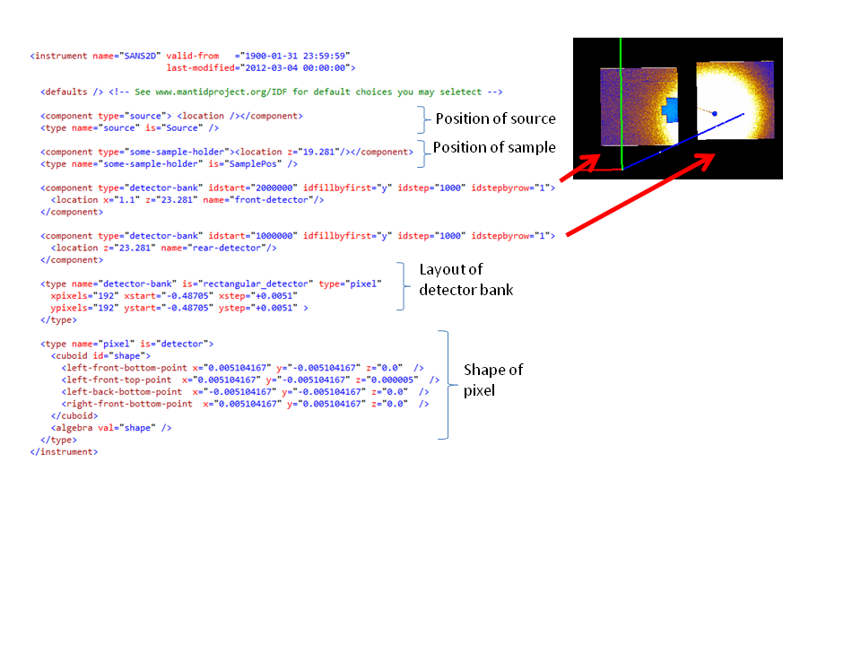

# IDF (ISIS)

*Migrated from the retired Mantid wiki page `Workshop2012_IDF_ISIS`.*

[IDF](https://docs.mantidproject.org/nightly/concepts/InstrumentDefinitionFile.html)



### To improve notation

```xml
      <locations r="2.5" t="121.19498" r-end="2.5" t-end="135.69059" n-elements="1024" name="tube_1_/>

       <!-- namelist="tube_1_1, tube_1_2...." -->
```

```xml
  <parameter-files>
    <parameter-file name="BOB_Parameter1.xml" order="1"/>
    <parameter-file name="BOB_Parameter2.xml" order="2"/>
  </parameter-files>
```

[IDF: Using *fitting* &lt;parameter&gt;](https://docs.mantidproject.org/nightly/concepts/InstrumentDefinitionFile.html#using-fitting-parameter)

### Triple axes

1. Define instrument for one orientation

2. Group workspace containing (or new type of workspace, or a form of MD workspace)

MatrixWorkspace (some orientation of instrument)

MatrixWorkspace (some orientation of instrument)

.

.

.

MatrixWorkspace (some orientation of instrument)
