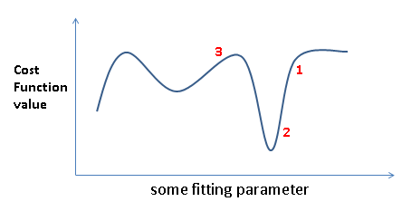
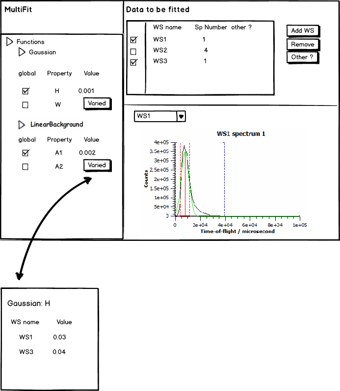

# Model optimization

*Migrated from the retired Mantid wiki page `Workshop2014_model_optimization`.*



For local optimizer depending on your position you end of in different local minima and in different execution durations.

### Example: global optimization

```python
# Demonstrate the global optimization alg: multi-start downhill optimization.
# This simple alg is here demonstrated by fitting a Gaussien to a region of
# data with a bumpy peak on a bumpy background where the multi-start is
# repeated with random starting positions of center of the Gaussian

# One way to run this script:
#    1. Execute entire script
#    2. In MantidPlot plot spectrum 0-1 of both fit_Workspace and best_fit_so_far_Workspace
#    3. Position the two plot windows side-by-side and re-execute script

from random import random
from time import sleep

# HRP39182 needs to be in your path or specify full path filename
# This dataset can be downloaded from Mantid download: where contained in TrainingCourseData.zip
HRP39182 = Load('HRP39182')
startX = 93000
endX = 93300

# Uncomment in case you want to just to a single fit
#Fit(InputWorkspace='HRP39182', WorkspaceIndex=0, \
#	   StartX = startX, EndX=endX, Output='fit', \
#	   Function='name=Gaussian,Height=10,PeakCentre=93150,Sigma=20')

# keep track of the best chi-squared (cost function) value found
chiSqBest = 1e+100 # some very large starting value

# number of random starting points to start local minimization from
numStartingPoints = 20

for i in range(numStartingPoints):
	# vary the center of the peak
	tryCentre = str(startX + random()*(endX-startX))

	# do local minimization from this starting position
	d0, chiSq, d1, d2, d3 = Fit(InputWorkspace='HRP39182', WorkspaceIndex=0, \
	   StartX = startX, EndX=endX, Output='fit', \
	   Function='name=Gaussian,Height=10,PeakCentre='+tryCentre+',Sigma=20')

	# keep a record of the best fit so far
	if chiSq < chiSqBest:
		chiSqBest = chiSq
		CloneWorkspace(InputWorkspace='fit_Workspace',OutputWorkspace='best_fit_so_far_Workspace')
		#if i == 0:
		#	plotSpectrum('fit_Workspace', '0,1')
		#	plotSpectrum('best_fit_so_far_Workspace', '0,1')

	print chiSq
	# slow down the loop to be able to watch the progress in a plot window
	sleep(2)
```

### Example multi spectra fitting

```python
# demostrating multispectra fitting

# Create 3 spectra to fit a model against where the 2nd and 3rd spectra are
# identical apart from a scale factor of 2.0
# Note MUSR00015189 can optionally be downloaded from training course blah
musr = Load('MUSR00015189')
musr = CropWorkspace(InputWorkspace='musr', StartWorkspaceIndex=0, EndWorkspaceIndex=0)
musr_1 = Rebin('musr_1','0.5,0.1,30')
musr_2 = Rebin('musr_2','0.5,0.1,30')
musr_3 = Rebin('musr_2','0.5,0.1,30')
musr_3 *= 2.0
musr=GroupWorkspaces('musr, musr_3')
workspaces = ['musr_1','musr_2','musr_3']

# fit 3 spectra simultaneously: one from each workspace
func= """
composite=MultiDomainFunction,NumDeriv=1;(
    composite=CompositeFunction,$domains=0;
    name=LinearBackground,A0=0,A1=0,ties=(A1=0);
    name=UserFunction,Formula=Intensity*exp(-(x/Tau)^Beta),Intensity=1000.0,Tau=2,Beta=1
);
(
    composite=CompositeFunction,$domains=1;
    name=LinearBackground,A0=0,A1=0,ties=(A1=0);
    name=UserFunction,Formula=Intensity*exp(-(x/Tau)^Beta),Intensity=1000.0,Tau=2,Beta=1
);
(
    composite=CompositeFunction,$domains=2;
    name=LinearBackground,A0=0,A1=0,ties=(A1=0);
    name=UserFunction,Formula=Intensity*exp(-(x/Tau)^Beta),Intensity=1000.0,Tau=2,Beta=1
);"""

kwargs = {'InputWorkspace_2': 'musr_3', 'InputWorkspace_1': 'musr_2', 'WorkspaceIndex_1': 0, 'WorkspaceIndex_2': 0}

# do the fit
Fit(Function=func,InputWorkspace=workspaces[0],WorkspaceIndex=0,Output='output',Minimizer='Levenberg-MarquardtMD,Debug=1',**kwargs)
```

### multi spectra fitting gui style


