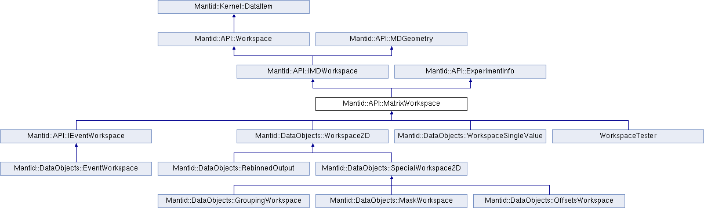
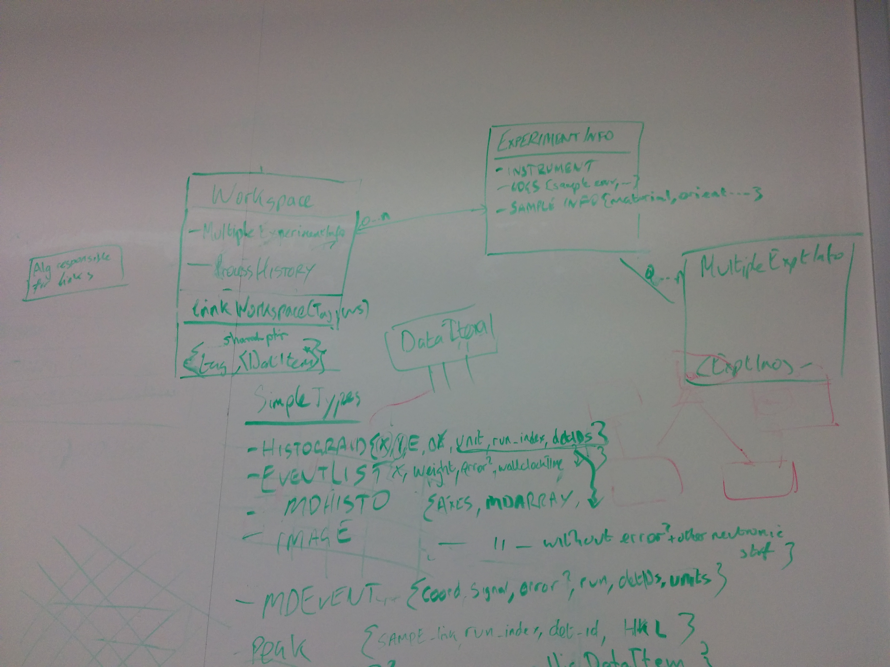
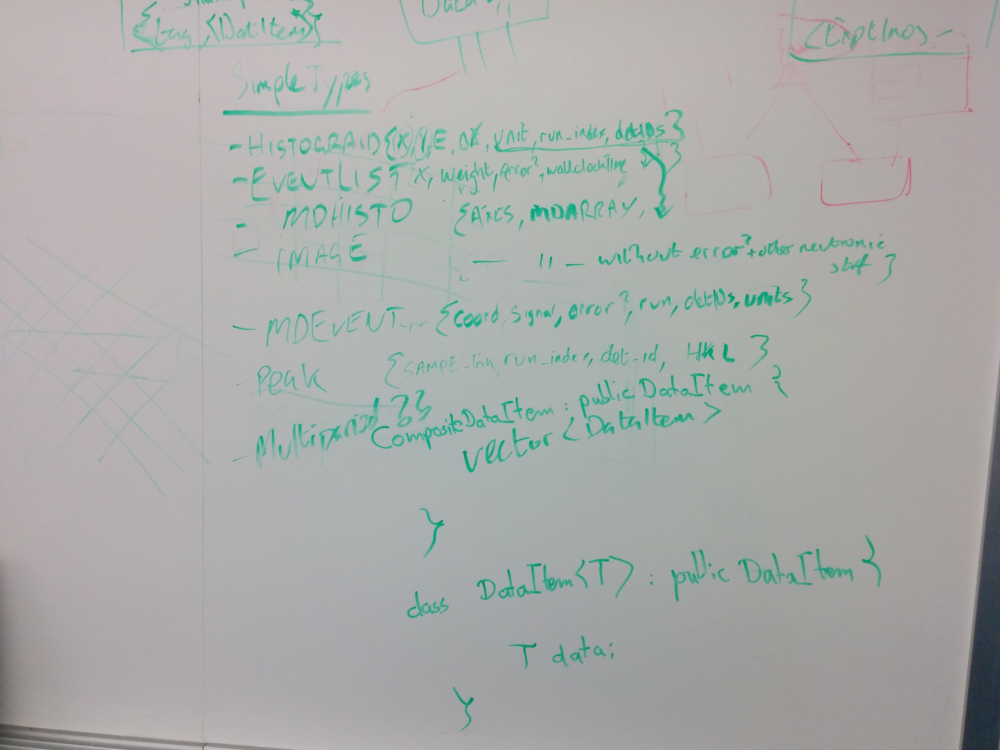

# Thursday small groups

*Migrated from the retired Mantid wiki page `DevWorkshop2016_Thu_small_group`.*

## Mantid as a python library

Three main areas:

1. Improving the interface to access data and create workspaces in Python
   1. CreateWorkspace is a particular problem, create a workspace in python, add the data you want and then register/save in mantid.
   2. Workspaces should work with the minimum amount of data required
   3. Tableworkspaces are very unpleasant.
   4. Ensure cloning works nicely in python
   5. Need to be able to add a limited instrument using just L2, theta (efixed) lists (Not for instrument view, just for unit conversion)
2. Defining a Core set of functions
   1. define a core set of operations (Primarily maths + rebin, convert units)
   2. Expose the looped operations to python directly (Note: these will not the the exact equivalent of the algorithm). (Timmy is keen on this, but it is not clear that others would use it.)
3. changing framework from a python wrapped package to python package with c++ innards

## Interaction with experiment control

The aim is to make Mantid unaware of experimental control. Mantid is a passive service to experimental control. Interaction the other way around does not yet make sense. Essentially this means we need to have the following.

1. Mantid needs to be made very stable so that it can reliably be used over long durations of an experiment.
2. Mantid needs to be made thoroughly pythonic so that we can glue it to the instrument control framework via python.
3. Geometry should be separable from the data reduction parts of Mantid
4. A headless distribution of Mantid may be an advantage

## Workspaces

The current workspace hierarchy has grown organically to support a changing set of requirements. The `MatrixWorkspace` hierarchy as it currently stands looks like:

It is apparent from the tree that all of the variation across the classes stems from different storage requirements. MatrixWorkspace inherits `ExperimentInfo`, which forces everything to inherit that interface. The whiteboard sessions proposed the following structure:

The `Workspace` type becomes a simple container type composed of experiment information, processing history & data pointers. All fields are allowed to be null. A base class `DataItem<code> will allow classes for holding data in varying formats accessed through this class.
`

Action: This needs to be formalised into a concrete design proposal to stress the design more (Martyn).
