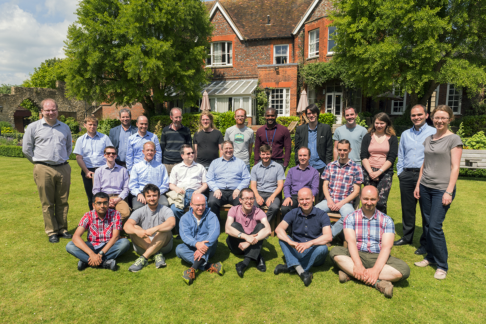

# Mantid Developer Workshop 2017

*Migrated from the retired Mantid wiki page `Category:Workshop2017`. Hotel and travel logistics were not carried over.*

### June 14 - Wednesday

**Location: The Cosener's House**

**Theme: Sustainability and Reliability**

09:00 **Morning**

- Welcome (Nick)
- Feedback of Software Sustainability Institute Report & Discussion (Pete)
- Branches / packages / pipelines (Ross)
- GitHub workflow - Define a consistent mechanism for working with GitHub review mechanism. Example [pull request](https://github.com/mantidproject/mantid/pull/19741) (Martyn)

10:30: **Tea/Coffee**

- Code camp (small groups):
   - What new tools are out there and could we benefit from them?
   - Documentation Improvements - small group to 'hack' at more cohesive overall documentation.
      - Move much of API reference to links under concepts
      - Link more python types in sphinx
      - Add links from python exported class docs to other objects, e.g. MatrixWorkspace.getRun()->Run to give link to Run
      - Add dropdown box to select versions in online docs

12:00 **Lunch**

13:00 **Afternoon**

- "This has always bugged me" group therapy session? (Martyn) (45 mins)

- Mantid at the ILL (Antti/Gagik) (45 mins)

15:30: **Tea/Coffee**

**New tools**

- [repl.it](https://repl.it/) online compiler. Saves session. Multiple languages, compiler versions of GCC. Version control in session. How does it compare to [wandbox](https://wandbox.org/)?
- Profiling tools: VS profiling tools, valgrind/callgrind, perftools.
- Git-clang-format.py
- [vagrant](https://www.vagrantup.com/). Way to script the creation of virtual machines.
- [ConEmu](https://conemu.github.io/) console emulator.
- [dreampie](http://www.dreampie.org/). Light weight python IDE.
- [cotire](https://github.com/sakra/cotire) (compile time reducer) for precompiled headers. 10% build speed up for Algorithms. Just a cmake module to use like [this](https://github.com/mantidproject/mantid/pull/19852/).
- [Google bench](https://github.com/google/benchmark) (google benchmark) micro benchmarking framework. Cmake project. Repeats tests to take averages. Nicely formatted out Will even tell you big-O compjelexity of your code. [example](https://github.com/DMSC-Instrument-Data/instrument-prototype/blob/master/cow_instrument/benchmark/DetectorInfoReadBenchmark.cpp)

Qt3D. Rather than OpenGL? Would this be a good idea?

**New Ways of Working**

- Interactive graphs for performance tests. Tell you which commit is responsible for dip/spike. D3 or some other javascript solution to this?
- Automating the process of checking the performance jobs.
- Sharing git alias/cheat sheet

17:00: **End**

### June 15 - Thursday

**Location: The Cosener's House**

**Theme: Mantid is a scipy style library**

09:00 **Morning**

(Pulled over from Wednesday)

- Mantid at MLZ
- Mantid at FRM

- The Road to 4.0
- How does Python 3 fit into this
- Mantid is a scipy styled library - how do we make this a reality

10:30: **Tea/Coffee**

- Review and fix quick wins from user meeting (if any)
- Review output of "this has always bugged me session" and tackle most popular item
- Code camp/discussions (small groups):
   - builds are too slow on pull requests
   - Distributed processing for MDEventWorkspaces - an issue of concern
   - [Getting started with the DataProcessorWidget in Python (Anton)](https://antonpiccardoselg.github.io/slides/mantid_developer_workshop)
   - Organization/location of mantid4 gui

12:00 **Lunch**

13:00 **Afternoon**

- Instrument 2.0 plans & progress including scanning instrument support (Ian, Simon, Owen) (45mins)

15:30: **Tea/Coffee**

- Lightning Talks

| Title | Presenter |
| --- | --- |
| Recorder & Reversible Debugger: `rr` | Martyn Gigg |
| Overengineering software: [morebin](https://github.com/peterfpeterson/morebin) | Pete Peterson |
| [Summation in Q](http://slides.com/gemmaguest/summation_in_q#/) | Gemma Guest |

17:00: **End**

### June 16 - Friday

**Location: Rutherford Appleton Laboratory (RAL) - CR03**

**Theme: Better, faster, stronger development**

09:00 **Morning**

- Mantid/McStas: Overview & The Future (Anders Markvardsen) (30 mins)

10:30: **Tea/Coffee**

- Code camp/discussions (small groups)

- Compile time:
   - Incremental builds: 15min for compilation (average)
   - Shared ccache?
   - Distributed builds: IncrediBuild (commercial), distcc (gcc)
      - Summary of IncrediBuild:
         - Network into a supercomputer! And claim to by 30 times faster!
         - Possibly (minor?) concern: Mantid incremental build can generate segmentation faults
         - We could have multiple subset for Windows, Linux etc - although I think there was a cross platform option
         - Spare hardware used better
         - Development machines don't need to be as high spec
         - $1500 for 1 year for 5 agents: 1 agent means 1 developer. ISIS could prototype this if deemed useful
         - Otherwise $500-600 per agent with no time-limit as far as I could tell
      - ccache with distcc? -> Setup distcc, `export CCACHE_PREFIX=distcc` (seems to work, need actual setup for testing speedup)
      - distcc pump-mode: [https://opensource.googleblog.com/2008/08/distccs-pump-mode-new-design-for.html](https://opensource.googleblog.com/2008/08/distccs-pump-mode-new-design-for.html), [http://manpages.ubuntu.com/manpages/xenial/man1/distcc-pump.1.html](http://manpages.ubuntu.com/manpages/xenial/man1/distcc-pump.1.html) (have not tried this yet)
   - clcache -> ccache for Windows
   - [https://buildbloat.neocities.org/](https://buildbloat.neocities.org/)

12:00 **Lunch**

13:00 **Afternoon**

15:30: **Tea/Coffee**

17:00: **Adjourn**

- Small group topics
   - Plan for working effectively with code base containing full application written in Python, i.e. cmake, setuptools, IDE support, packaging, static analysis
   - too many markup/markdown syntaxes for documentation
   - IntArrayProperty always expands the string representation - pretty print
   - MantidPlot takes too long to startup - part of it is initializing algorithm properties
   - Consolidate developer documentation (e.g. setup, cmake, data, ...)
      - Sort out where it is and how it should be version control
      - Special workspace types, how to create them
      - List of developers with technique
      - Links to PMB and TSC members and terms
      - Cases of code ported from FORTRAN where all that is mentioned is that they are a port
      - Domain "slang" should be explained
      - Tutorial page for introduction to techniques
      - Better navigation between versions of docs.mantidproject.org
      - Change history suggestions in algorithms
   - FortranVector
   - More developers building with ParaView/VSI
      - Push more people towards paraview-build
   - Need to build much of Framework to test out things
   - Speed up Unit Tests -[Spreadsheet](https://docs.google.com/spreadsheets/d/1nV7teMHJHBXg2eTxMlevrhwVhIJjOM6vTMJMByb8s48/edit?usp=sharing) of current timings
   - Brainstorming on how to make builds faster (e.g. faster compiling, splitting out testing differently)
   - Small group to hack on [Leeroy](https://github.com/rosswhitfield/leeroy) - Add in the cancel old builds for pull request and a few other features that were added upstream
   - Investigate [Jenkins 2.0 Pipeline](https://jenkins.io/doc/book/pipeline/) configuration with aim to extract Jenkins config into files committed to git.
   - Explore ideas for GUI testing in conjunction with MVP pattern. Tools such as QTest, for example.
   - Other topics of interest...?

## Place to put presentations

Presentations can be stored here [[[1]](https://github.com/mantidproject/documents/tree/master/Presentations/DevMeetings/2017-06)]
