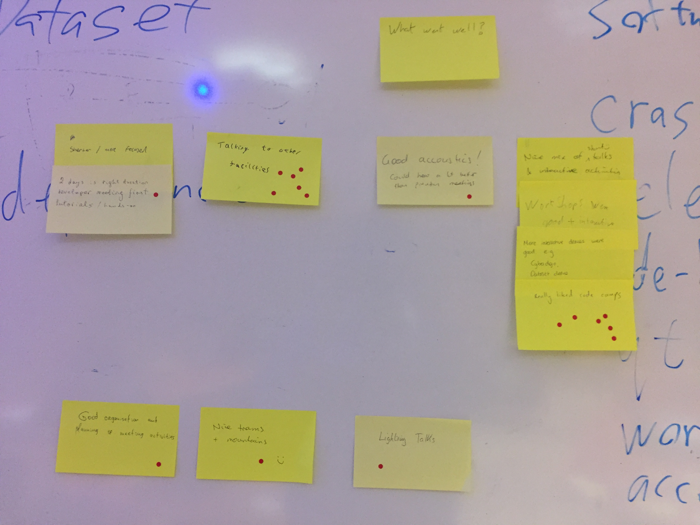
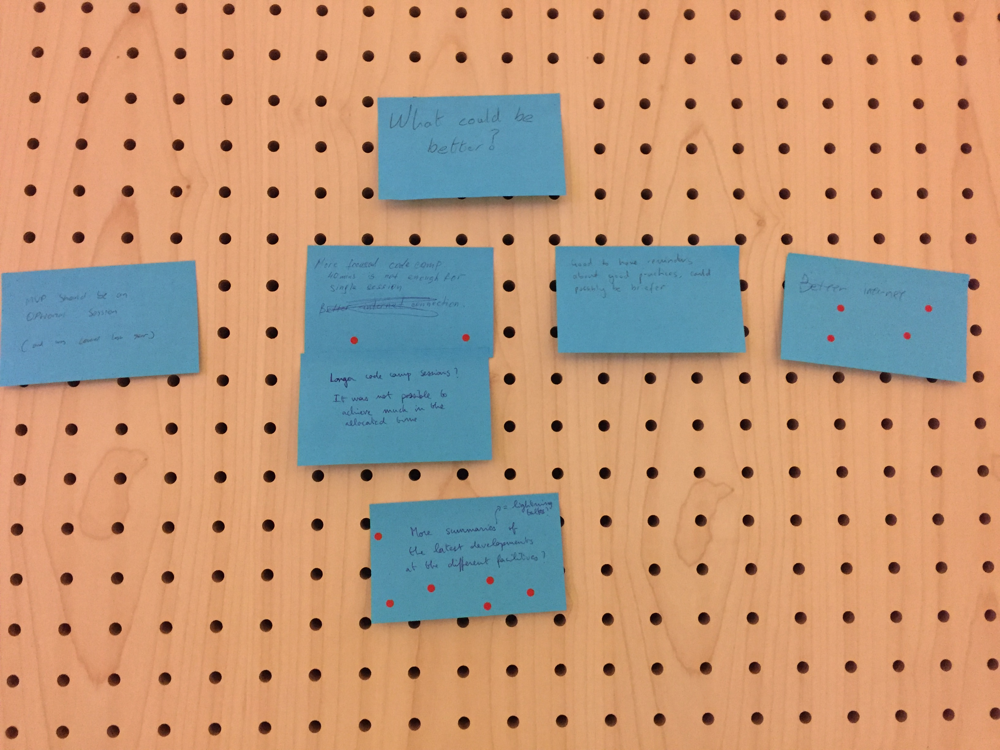
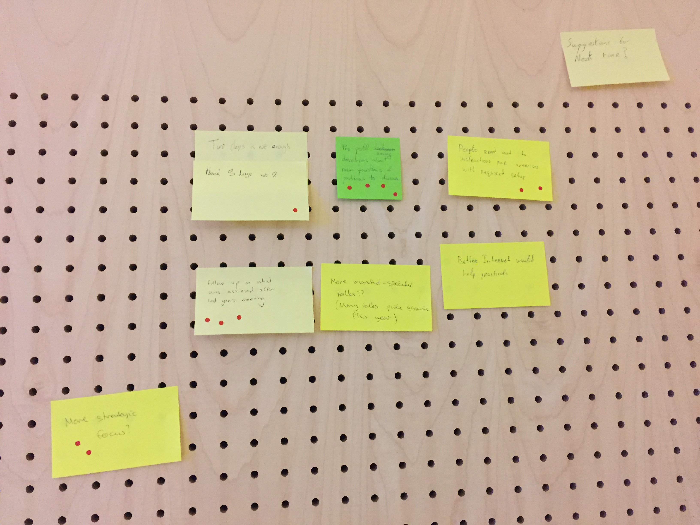

# Mantid Developer Workshop 2019

*Migrated from the retired Mantid wiki page `Category:Developer_Workshop_2019`. Hotel and travel logistics were not carried over.*

**Please bring a laptop with a recent build of the master branch**

#### When

1-3 April 2019

#### Where

ILL Seminar Room, ILL 4, **Room 163** (first floor).

ILL, Grenoble

#### Organising Committee

- Technical Steering Committee

## Agenda

### Monday Afternoon

| 13:00 | Welcome and Overview of the workshop (Nick) 15 min |
| --- | --- |
| 13:15 | [MVP tutorial](https://github.com/mantidproject/documents/blob/master/Presentations/DevMeetings/2019-04/MVP_Tutorial.pdf) (Dimitar)  |
| 14:30 | Coffee |
| 15:00 | MVP hands on session / code camp (Dimitar)  "This has always bothered me about mantid" session (Pete) |
| 17:30 | adjourn  |

### Tuesday

| 09:00 | Lightning Talks   Lightning talks are 5-15 minutes and do not have to be about mantid. However, the talk should be something of interest to mantid developers.     [Faster **ConvertMD**](https://github.com/mantidproject/documents/blob/master/Presentations/DevMeetings/2019-04/NewConvertToMD.pdf) (Igor)   [Profiling tool for Mantid](https://github.com/mantidproject/documents/blob/master/Presentations/DevMeetings/2019-04/NeilVaytet_MantidProfiler.pdf) (Neil, Igor)   Containers, and why scientific software really needs them (Dan, 4 mins)   12 open source tools you'll probably never use (Dan, 5 mins)   Making the internet slightly less terrible (Dan, 4 mins)   1000 algorithms: too many? too few? or just enough? (Gagik, 4.57 mins)    [Mantid at Arch Linux: development at the bleeding edge](https://github.com/mantidproject/documents/blob/master/Presentations/DevMeetings/2019-04/mantid_on_arch_linux.pdf) (Marina, 5 min)    Error reporter what does it actually do and where does it go (Mat, 4 min)  [C++ On Sea Highlights](https://github.com/mantidproject/documents/raw/fdc79773c99af56374a8fce6dd1c7888ad22e477/Presentations/DevMeetings/2019-04/Tales from C++ On Sea.pdf) (Martyn, 10 mins)   [SANS Challenges](https://www.slideshare.net/ricleal/sans-challenges-139202264) (Ricardo, 4 mins)  Code camp |
| --- | --- |
| 10:30 | Coffee |
| 11:00 | Code camp |
| 12:00 | Lunch |
| 13:00 | Code camp |
| 14:00 | Deliberate practice, identifying flawed methodology and simulating years of bad code in 30 minutes - part 1 (Dan, 30-40 mins) |
| 14:30 | Coffee |
| 15:00 | Deliberate practice, identifying flawed methodology and simulating years of bad code in 30 minutes - part 2 (Dan, 60-80 mins)&lt;/br>  [Maximising value in the code review process](https://slides.com/gemmaguest/maximising-value-in-the-code-review-process/) (Gemma)   What does "testing documentation" mean? (Nick)   Deciding what level of design is appropriate and when to involve others (Martyn)  Shorter development cycles (Nick) |
| 17:30 | adjourn  |

### Wednesday Morning

| 09:00 | Code camp, [Dataset](https://github.com/scipp/scipp) demo/hands-on (Simon). Obtain image from [dockerhub](https://hub.docker.com/r/dmscid/dataset) ahead of camp. |
| --- | --- |
| 10:30 | Coffee |
| 11:00 | Code camp |
| 11:30 | [How to assist in the user breakout sessions](https://github.com/mantidproject/documents/blob/master/Presentations/Scientific Steering Committee/User Workshop 2019/Mantid Users Workshop - Breakout guidance (2019).docx) (Nick)   Developer workshop retrospective (Nick) |
| 12:00 | Lunch |
| 13:00 | adjourn for start of Mantid Users Workshop 2019 |

## Place to Put Presentations

- [In github](https://github.com/mantidproject/documents/tree/master/Presentations/DevMeetings/2019-04)

## Code Camp Ideas

- Go over "old" issues and decide if they are still valid
- Dead code hunting
- Hunt for TODO and FIXME
- Assess move to Conan for dependency management on all OSs.
   - Aim to check Conan can provide everything we need, e.g. target previous macOS versions, how to provide Python for Windows
   - Come up with an implementation plan to move from current state
- Build server stuff
   - Removing old/unused Jenkins jobs
   - Move non-mantid/trivial stuff off Jenkins (those that can easily be built on public CI services (Travis Appveyor, etc.) e.g. MantidImaging, MSlice, etc.)
   - Testing pipeline builds with a distributed Kubernetes cluster
- Fixing unreliable tests - present fixes to group as things to avoid ([LiveDataTest](http://builds.mantidproject.org/job/pull_requests-ubuntu/28594/) is high on the list)
- Workbench manual testing and fixing
- Evaluate moving systemtests to use less custom code and more of unittest.TestCase
- Fold system tests into CTest (needs to be evaluated first)
- Technique breakouts
   - constant wavelength
   - total scattering
   - single crystal
   - SANS
- Inventory the NeXus helper/utility code in mantid and create plan for merging it together
- Paraview build script
- OSX support
- Workbench sliceviewer
- Webserver/single point of failure
- Unit test are not unit tests
- Update/improve Mantid exception system

### Have concrete results

These should provide descriptions/links to follow-on or results

- Profile CSNS data: Considering event data [https://doi.org/10.1063/1.5034782](https://doi.org/10.1063/1.5034782) [http://dx.doi.org/10.1016/j.nima.2015.09.016](http://dx.doi.org/10.1016/j.nima.2015.09.016)
- Unreliable tests:
   - Identified an issue with creating geometry cache for same instrument when multiple tests run in parallel
   - We should improve the good practice guide for writing unit tests
   - Look into address sanitizer issues and fix them all
   - System tests running in parallel require more memory and can fall over
- Speeding up slow tests: Identifying slow unit and system tests and suggestions to speed up [results spreadsheet](https://docs.google.com/spreadsheets/d/1uzAhnFM9Q8jMmrOzaZ32oBx_SDIdojKUgps9-EXpslo/edit?usp=sharing)
- Multiple hdf libraries
- Adding nanosecond resolution to Kernel/Timer.h and folding that into algorithm profiling: [branch was created](https://github.com/mantidproject/mantid/compare/timer_substitution)
- Technique breakouts
   - Indirect inelastic: Will test PR's across facilities and work closer together to ensure the GUIs can be used at multiple facilities.
   - Total scattering: Discussed medium and long term plans. There is an issue with current lack of staff on the topic. Would like to arrange for a dedicated week of code camp, likely hosted at ISIS.
- Create guide for modernizing code when editing - present to all attendees: [link to issue](https://github.com/mantidproject/mantid/issues/25459)
- Cleaning up the github repositories: several unused repositories archived, and several more pinned [Mantid Github home page](https://github.com/mantidproject)
- Web server/single points of failure: adding descriptions for all our web services to the ansible-linode repository readme. Getting rid of Mailman - move developers list to slack, help emails post to the forum: [link to issue](https://github.com/mantidproject/mantid/issues/25463)

### Retrospective Results

#### What went well?

#### What could be betterl?

#### Suggestions for next time?

