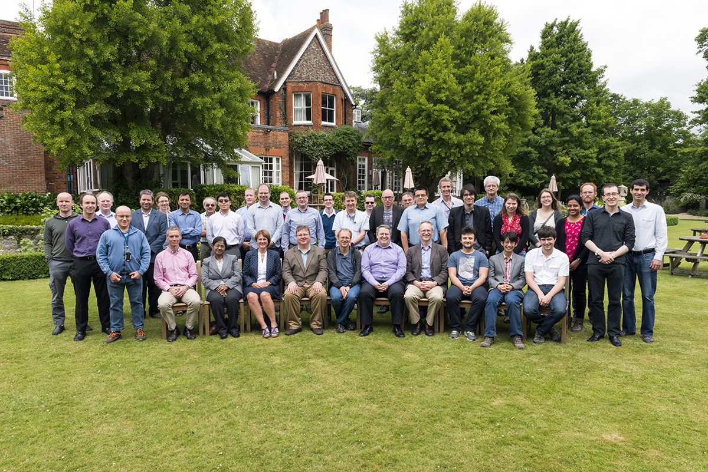

# Mantid Users Workshop 2017

*Migrated from the retired Mantid wiki page `Category:Users_Workshop_2017`. Hotel and travel logistics were not carried over.*

| Attendees |  |  |  |
| --- | --- | --- | --- |
| **RAL** | **ORNL** | **ESS** | **ILL** |
| Diffraction |  |  |  |
| Helen Playford   Pascal Manuel   Tung Lik Lee | Xiaoping Wang |  |  |
| Direct Inelastic |  |  |  |
| Toby Perring   Duc Le | Doug Abernathy  Garrett Granroth   Andrei Savici | Jon Taylor |  |
| Indirect Inelastic |  |  |  |
| Sanghamitra Mukhopadyay | Timmy Ramirez-Cuesta |  |  |
| Muons |  |  |  |
| Stephen Cottrell   Adrian Hillier  James Lord |  |  |  |
| Small Angle |  |  |  |
| Steve King | Chris Stanley | Andrew Jackson |  |
| Reflectometry |  |  |  |
| Max Skoda |  |  |  |

#### When

12-13 June 2017

#### Where

The Cosener's House, Abingdon, Oxfordshire, UK

#### Organising Committee

- Stephen Cottrell (stephen.cottrell@stfc.ac.uk)
- Nick Draper (nick.draper@stfc.ac.uk)

## Focus of the meeting

1. To present on progress on the items raised at the 2016 Scientific steering committee
2. To capture and discuss the requirements of the scientific groups over the next 1-2 years.
3. To discuss planned strategic and technical developments
4. To share best practice and encourage collaboration.

## Pre Meeting Work

This meeting is to discuss and present the 1-2 year requirements for the Mantid project, in order for the meeting to be a success we would greatly appreciate it if you could bring a good understanding of the needs of your group over this period and be prepared to discuss them in the breakout session.

## Agenda

## Monday

### Monday Morning

| 10:00 | Coffee |
| --- | --- |
| 10:30 | [Welcome](https://github.com/mantidproject/documents/blob/master/Presentations/DevMeetings/2017-06/MantidWelcome.pptx?raw=true) (Debbie Greenfield)  [Mantid Users Workshop Changes](https://github.com/mantidproject/documents/blob/master/Presentations/DevMeetings/2017-06/MUW - Intro.pptx?raw=true) (Stephen Cottrell)  [Current implementation and future plans from ISIS](https://github.com/mantidproject/documents/blob/master/Presentations/DevMeetings/2017-06/ISIS_Facility_update.pptx?raw=true) (Pascal Manuel)  [Current implementation and future plans from ORNL](https://github.com/mantidproject/documents/blob/master/Presentations/DevMeetings/2017-06/ORNL_perspective.pptx?raw=true) (Garrett Granroth)  [Current implementation and future plans from ESS](https://github.com/mantidproject/documents/blob/master/Presentations/DevMeetings/2017-06/Matid At ESS.pdf?raw=true) (Jon Taylor)  [Current implementation and future plans from ILL](https://github.com/mantidproject/documents/blob/master/Presentations/DevMeetings/2017-06/Mantid at ILL.pptx?raw=true) (Ian Bush)  |
| 11:45 | Group Photo  |
| 12:00 | Lunch |

### Monday Afternoon

| 13:00 | Strategic Priorities (Chair of the Project Management Board, Jon Taylor)  [Technical Priorities](https://github.com/mantidproject/documents/blob/master/Presentations/DevMeetings/2017-06/TSC_report.pptx?raw=true) (Peter Peterson)  [Mantid 4.0 and other areas for discussion](https://github.com/mantidproject/documents/blob/master/Presentations/DevMeetings/2017-06/Mantid 4.pptx?raw=true) (Nick Draper)  [Mantidplot TNG](https://github.com/mantidproject/documents/blob/master/Presentations/DevMeetings/2017-06/MantidPlot TNG.pptx?raw=true) (Martyn Gigg)  [Algorithm Renaming](https://github.com/mantidproject/documents/blob/master/Presentations/DevMeetings/2017-06/Mantid4PythonLibrariesAndNames.md) (Andrei Savici)  [Property Renaming](https://github.com/mantidproject/documents/blob/master/Presentations/DevMeetings/2017-06/PropertyInfo.md) (Andrei Savici)  |
| --- | --- |
| 14:00 | Discussion in science based groups  |
| 15:00 | Break |
| 15:30 | Discussion in science based groups   |
| 17:00 | Adjourn |

### Monday Evening

| 18:30 | Dinner at The Consenors House, Abingdon |
| --- | --- |

## Tuesday

### Tuesday Morning

| 09:00 | Science talks - using Mantid to enable science  [How I use Mantid- and how I would like to use it](https://github.com/mantidproject/documents/blob/master/Presentations/DevMeetings/2017-06/Abernathy_MantidUsers_2017.pptx?raw=true) (Doug Abernathy)  [Crystal Fields Modelling and Fitting in Mantid](https://github.com/mantidproject/documents/blob/master/Presentations/DevMeetings/2017-06/Crystal Fields Modelling and Fitting in Mantid.ppt?raw=true) & [Demo](http://htmlpreview.github.io/?https://github.com/mantidproject/documents/blob/master/Presentations/DevMeetings/2017-06/170612_mantid_crystal_field_demo.html) (Duc Le)  [Muons](https://github.com/mantidproject/documents/blob/master/Presentations/DevMeetings/2017-06/Mantid and Muons.pptx?raw=true) (James Lord)   [Condensed Matter Science at Molecular Spectroscopy Group](https://github.com/mantidproject/documents/blob/master/Presentations/DevMeetings/2017-06/Indirect roundup 2017.pdf?raw=true) (Sanghamitra Mukhopadhyay)   Chris Stanley |
| --- | --- |
| 10:15 | Discussion and coffee  |
| 10:45 | Discussion in science based groups - continued  |
| 12:00 | Lunch |

### Tuesday Afternoon

| 13:00 | Demos / Workshops  |
| --- | --- |
| 13:30 | Continue in breakout rooms   Groups generate a list of ideas / requirements to present later |
| 15:00 | Break |
| 15:30 | Group presentations and discussion   [Diffraction](https://github.com/mantidproject/documents/blob/master/Presentations/DevMeetings/2017-06/DiffractionReport_2017.pptx?raw=true) (Pascal Manuel)   Muons (Stephen Cottrell)   [Direct Geometry Inelastic](https://github.com/mantidproject/documents/blob/master/Presentations/DevMeetings/2017-06/MantidUser2017_Direct_Geometry_Inelastic.docx?raw=true) (Doug Abernathy)   [Indirect Geometry Inelastic](https://github.com/mantidproject/documents/blob/master/Presentations/DevMeetings/2017-06/Indirect Requirements.pdf?raw=true) (Louise McCann)   [SANS-NR](https://github.com/mantidproject/documents/blob/master/Presentations/DevMeetings/2017-06/SANS-NR Breakout.pptx?raw=true) (Steve King)   |
| 16:45 | [Closeout](https://github.com/mantidproject/documents/blob/master/Presentations/DevMeetings/2017-06/MUW - End.pptx?raw=true) (Stephen Cottrell) |
| 17:00 | Adjourn |
