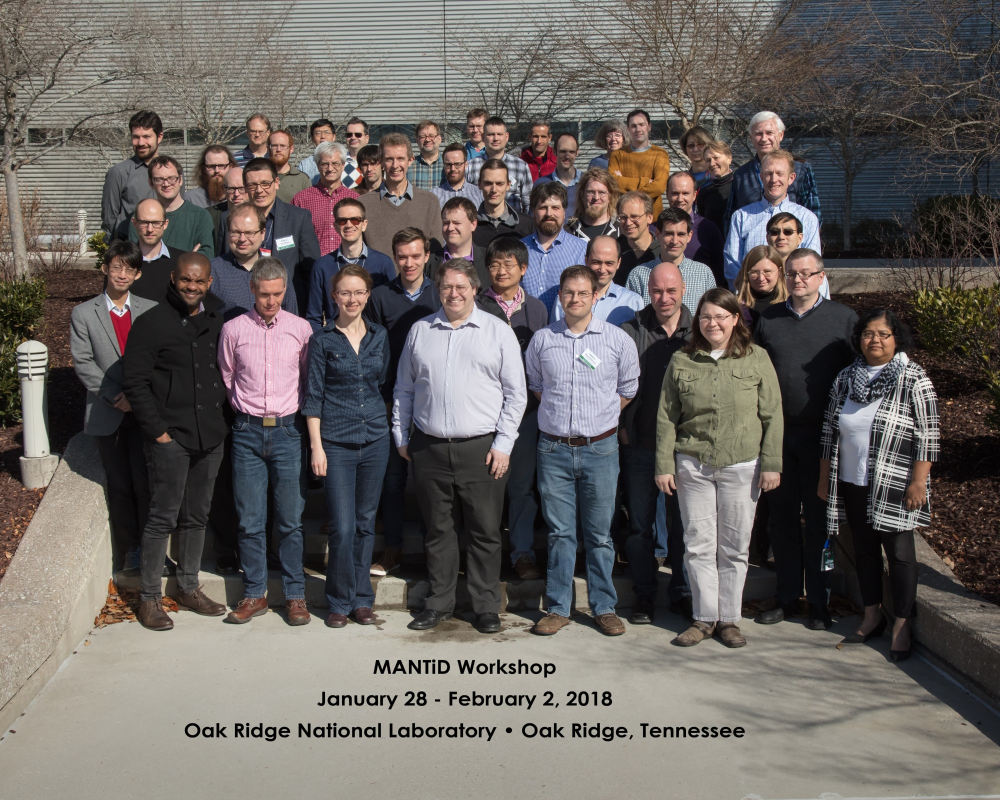

# Mantid Users Workshop 2018

*Migrated from the retired Mantid wiki page `Category:Users_Workshop_2018`. Hotel and travel logistics were not carried over.*

#### When

29-30 January 2018

#### Where

SNS CLO room C156. Oak Ridge National Laboratory, Oak Ridge, TN ,USA

#### Organising Committee

- Stephen Cottrell
- Peter Peterson
- Doug Abernathy
- Nick Draper
- Andrew Jackson
- Paolo Mutti

## Focus of the meeting

1. To present on progress on the items raised at the 2017 Scientific steering committee
2. To capture and discuss the requirements of the scientific groups over the next 1-2 years.
3. To discuss planned strategic and technical developments, including Mantid 4.0
4. To share best practice and encourage collaboration.

## Pre Meeting Work

This meeting is to discuss and present the 1-2 year requirements for the Mantid project, in order for the meeting to be a success we would greatly appreciate it if you could bring a good understanding of the needs of your group over this period and be prepared to discuss them in the breakout session.

## Agenda

## Monday

### Monday Morning

| 09:30 | Coffee |
| --- | --- |
| 10:00 | Welcome (Paul Langan - NScD) 10min  Overview of the workshop (Stephen Cottrell - chair) 10 min  Formation of Breakout groups, nomination of chairs |
| 10: 30 | Facility updates (incl discussion) 15 min each   [Facility news and updates from ISIS](https://github.com/mantidproject/documents/blob/master/Presentations/Scientific Steering Committee/SSC 2018/ISIS_FacilityUpdate2018.ppt?raw=true) (Pascal Manuel)  [Facility news and updates from ORNL](https://github.com/mantidproject/documents/blob/master/Presentations/Scientific Steering Committee/SSC 2018/ORNL_overview.pptx?raw=true)(Garrett Granroth)  [Facility news and updates from ESS](https://github.com/mantidproject/documents/raw/master/Presentations/Scientific Steering Committee/SSC 2018/ESS-Update.pdf) (Jon Taylor)  [Facility news and updates from ILL](https://github.com/mantidproject/documents/blob/master/Presentations/Scientific Steering Committee/SSC 2018/MantidWorkshop2018ILL.pptx?raw=true) (Gagik Vardanyan)  [Facility news and updates from MLZ](https://github.com/mantidproject/documents/raw/master/Presentations/Scientific Steering Committee/SSC 2018/MLZ_facility_update.pdf) (Marina Ganeva)  |
| 12:00 | Group Photo  |
| 12:15 | Facility cooperation discussion with working lunch |

### Monday Afternoon

| 13:30 | [Talk: YQ Cheng, ORNL, “Data analysis, DFT modeling, and INS simulation at VISION”](https://github.com/mantidproject/documents/blob/master/Presentations/Scientific Steering Committee/SSC 2018/vision.pptx?raw=true) |
| --- | --- |
| 14:00 | [Talk: Simon Heybrock, ESS, “Mantid on parallel computing architectures using MPI”](https://github.com/mantidproject/documents/raw/master/Presentations/Scientific Steering Committee/SSC 2018/mantid-user-2018-mpi.pdf) |
| 14:30 | [Mantid 4 introduction](https://github.com/mantidproject/documents/blob/master/Presentations/Scientific Steering Committee/SSC 2018/Mantid 4.pptx?raw=true) and demos (Nick & Martyn)  Hands on with Mantid 4.0   |
| 15:40 | Coffee |
| 16:00 | Discussion of Mantid 4.0 in science based groups   |
| 17:30 | Adjourn |

### Monday Evening

18:00 Dinner at [Calhoun's in Oak Ridge](https://calhouns.com/menus-and-locations/oak-ridge/) - Speaker: Thomas Proffen
- cash bar

## Tuesday

### Tuesday Morning

| 09:00 | [Talk: Martin Mourigal, Georgia Tech, "Modeling of diffuse and inelastic magnetic scattering from quantum materials"](https://github.com/mantidproject/documents/raw/master/Presentations/Scientific Steering Committee/SSC 2018/Mourigal.pdf) |
| --- | --- |
| 09:30 | Talk: William Heller, ORNL, “Machine Learning for Neutron Scattering Data at ORNL" |
| 10:00 | [Core team - Jon Taylor](https://github.com/mantidproject/documents/blob/master/Presentations/Scientific Steering Committee/SSC 2018/core_development.pptx?raw=true)  [Mantid crash reporting and data protection](https://github.com/mantidproject/documents/blob/master/Presentations/Scientific Steering Committee/SSC 2018/CrashReporing_KTB.ppt?raw=true) - Keith Butler |
| 10:30 | Coffee and Discussion  |
| 11:00 | Demos with working lunch   Addie - Marshall McDonnell  ORNL imaging (ipython notebooks) - Jean-Christophe Bilheux  Mantid Imaging for IMAT - Dan Nixon  PyVdrive - Wenduo Zhou  RefRed - Mathieu Doucet  ISIS SANS v2 - Matthew Andrew  mSlice - Duc Le and Martyn Gigg  Direct Inelastic reduction at the ILL - Antti Soininen   |

### Tuesday Afternoon

| 13:00 | [Talk: Duc Le, ISIS, “PACE: A framework for distributed data analysis of inelastic neutron spectra"](https://github.com/mantidproject/documents/blob/master/Presentations/Scientific Steering Committee/SSC 2018/duc_pace_mantidusermeeting2018.ppt?raw=true) |
| --- | --- |
| 13:25 | Continue in breakout rooms   Groups generate a list of ideas / requirements to present later |
| 15:00 | Coffee |
| 15:30 | Group presentations and discussion   [Diffraction](https://github.com/mantidproject/documents/blob/master/Presentations/Scientific Steering Committee/SSC 2018/Mantid_report_diffraction_2018.pptx?raw=true)[Indexing Sattelite group](https://github.com/mantidproject/documents/blob/master/Presentations/Scientific Steering Committee/SSC 2018/Index satellite and q.docx?raw=true)  [Muons](https://github.com/mantidproject/documents/blob/master/Presentations/Scientific Steering Committee/SSC 2018/Feedback - Muon group priorities (2018).pptx?raw=true)   [Direct Geometry Inelastic](https://github.com/mantidproject/documents/raw/master/Presentations/Scientific Steering Committee/SSC 2018/Mantid user meeting DG.pdf)  [SANS-NR](https://github.com/mantidproject/documents/blob/master/Presentations/Scientific Steering Committee/SSC 2018/SANS NR feedback from breakout 2018 SNS.pptx?raw=true)  [ISIS Indiect Spectroscopy](https://github.com/mantidproject/documents/blob/master/Presentations/Scientific Steering Committee/SSC 2018/High Priority Mantid Requirements 2017_March.doc?raw=true) (not present, but document submitted) |
| 16:45 | Closeout (Stephen Cottrell) |
| 17:00 | Adjourn |
