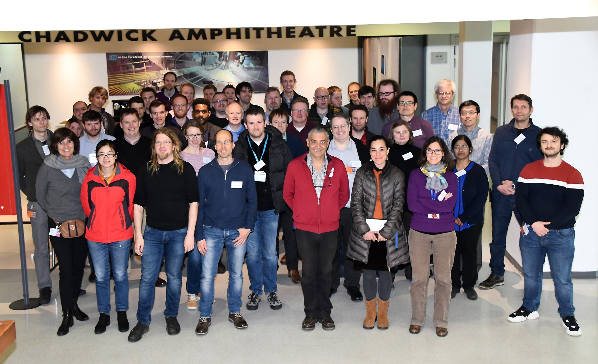

# Mantid Users Workshop 2019

*Migrated from the retired Mantid wiki page `Category:Users_Workshop_2019`. Hotel and travel logistics were not carried over.*

#### When

3-5 April 2019

#### Where

Amphitheater Chadwick, ILL 4 (ground floor)

Break out sessions:

- ILL 4 - Room 226 (second floor).
- ILL 4 - Room 264 (second floor).
- ILL 4 - Room 164 (first floor).
- ILL 4 - Room 163 (first floor).

ILL, Grenoble

#### Organising Committee

- Stephen Cottrell
- Miguel Gonzalez
- Nick Draper

## Focus of the meeting

1. To present on progress on the items raised at the 2018 Scientific steering committee
2. To capture and discuss the requirements of the scientific groups over the next 1-2 years.
3. To discuss planned strategic and technical developments, including Mantid Workbench, Python 3
4. To share best practice and encourage collaboration.

## Pre Meeting Work

This meeting is to discuss and present the 1-2 year requirements for the Mantid project, in order for the meeting to be a success we would greatly appreciate it if you could bring a good understanding of the needs of your group over this period and be prepared to discuss them in the breakout session.

## Agenda

## Wednesday

### Wednesday Afternoon

| 13:00 | Welcome - Mark Johnson  [Overview of the workshop - Stephen Cottrell](https://github.com/mantidproject/documents/blob/master/Presentations/Scientific Steering Committee/User Workshop 2019/MUW - Intro (2019).pptx?raw=true) |
| --- | --- |
| 13:15 | Science Talk 1: [Using Mantid for muon experiments, instruments and data - James Lord, Anthony Lim](https://github.com/mantidproject/documents/blob/master/Presentations/Scientific Steering Committee/User Workshop 2019/Mantid and Muons 2019 James_Anthony v2.pptx?raw=true)  |
| 13: 45 | Facility updates (incl discussion) max 15 min each   Facility news and updates from ISIS - Pascal Manuel  Facility news and updates from ORNL - Garrett Granroth  [Facility news and updates from ESS - Thomas Holm-Rod](https://github.com/mantidproject/documents/blob/master/Presentations/Scientific Steering Committee/User Workshop 2019/ESS_Updates_Mantid19.pptx?raw=true)  [Facility news and updates from ILL - Gagik Vardanyan](https://github.com/mantidproject/documents/blob/master/Presentations/Scientific Steering Committee/User Workshop 2019/MantidWorkshop2019ILL.pptx?raw=true)  [Facility news and updates from MLZ - Marina Ganeva](https://github.com/mantidproject/documents/raw/master/Presentations/Scientific Steering Committee/User Workshop 2019/MLZ update.pdf)  [Facility news and updates from CSNS - Rong Du](https://github.com/mantidproject/documents/blob/master/Presentations/Scientific Steering Committee/User Workshop 2019/CSNS_update.pptx?raw=true)   [Update on Mantid project governance - Nick Draper](https://github.com/mantidproject/documents/blob/master/Presentations/Scientific Steering Committee/User Workshop 2019/Mantid Governance.pptx?raw=true)  |
| 15:45 | Coffee |
| 16:10 | [Science Talk 2: Single crystal neutron diffraction beyond three dimensions - Xiaoping Wang](https://github.com/mantidproject/documents/raw/master/Presentations/Scientific Steering Committee/User Workshop 2019/Mantid_User_Meeting_2019_XPWang_Science.pdf) |
| 16:40 | [Science Talk 3: 3D neutron reflectometry on polyelectrolyte multilayers - Phillipp Gutfreund](https://github.com/mantidproject/documents/blob/master/Presentations/Scientific Steering Committee/User Workshop 2019/PolymerFilms.pdf)  |
| 17:10 | [Formation of Breakout groups, nomination of chairs, initial discussions - Stephen Cottrell](https://github.com/mantidproject/documents/blob/master/Presentations/Scientific Steering Committee/User Workshop 2019/MUW - Breakout (2019).pptx?raw=true)  |

### Wednesday Evening

Dinner: "Les jardins de Sainte Cecile", 18 rue de l'Alma at 20:00

## Thursday

| 09:00 | [Science Talk 4: SasView - Steve King](https://github.com/mantidproject/documents/blob/master/Presentations/Scientific Steering Committee/User Workshop 2019/SasView - Mantid User Meeting 2019.pptx?raw=true) |
| --- | --- |
| 09:30 | [Stability in Mantid - Anthony Lim](https://github.com/mantidproject/documents/blob/master/Presentations/Scientific Steering Committee/User Workshop 2019/stability_2019.pptx?raw=true) |
| 10:00 | [The new Mantid workbench](https://github.com/mantidproject/documents/raw/8eaddffd78dd6df62b7c1f261dc743e30ce3ad8a/Presentations/Scientific Steering Committee/User Workshop 2019/Mantid Workbench - User Meeting 2019.pdf) - Martyn Gigg |
| 10:30 | Coffee |
| 11:00 | Demos   Mantid workbench scripting  Mantid workbench plotting  ILL SANS Reduction |
| 11:50 | Group Photo  |
| 12:00 | Lunch |
| 13:00 | Science Talk 5: Inelastic neutron scattering on energy and organic ferroelectric materials - Sanghamitra Mukhopadhyay  |
| 13:30 | [Discussion of Mantid 4.0 in science based groups](https://github.com/mantidproject/documents/blob/master/Presentations/Scientific Steering Committee/User Workshop 2019/Mantid Users Workshop - Breakout guidance (2019).docx?raw=true) |
| 14:30 | Coffee |
| 15:00 | [Discussion of Science areas in science based groups](https://github.com/mantidproject/documents/blob/master/Presentations/Scientific Steering Committee/User Workshop 2019/Mantid Users Workshop - Breakout guidance (2019).docx?raw=true) |
| 17:30 | Science Talk 6: Time-of-flight data reduction at the ILL: From slide rule via crossx to mantid - Björn Fåk |

### Thursday Evening

Informal no-host dinner to be arranged

## Friday

### Friday Morning

| 09:00 | [Science Talk 7: Towards a Unified NR Reduction in Mantid - Max Skoda](https://github.com/mantidproject/documents/blob/master/Presentations/Scientific Steering Committee/User Workshop 2019/Towards a Unified NR Reduction in Mantid_v3c.pptx?raw=true)  |
| --- | --- |
| 09:30 | Continue in breakout rooms   Groups generate a list of ideas / requirements to present later |
| 10:15 | Coffee |
| 10:40 | [Science Talk 8: Reflectometry at the ILL - Thomas Saerbeck](https://github.com/mantidproject/documents/raw/master/Presentations/Scientific Steering Committee/User Workshop 2019/ILL-Reflectometry_Saerbeck.pdf)  |
| 11:10 | Group presentations and discussion   [Diffraction](https://github.com/mantidproject/documents/tree/master/Presentations/Scientific Steering Committee/User Workshop 2019/diffraction_breakout)  Muons   [Direct and Indirect Inelastic Spectroscopy](https://github.com/mantidproject/documents/blob/master/Presentations/Scientific Steering Committee/User Workshop 2019/inelastic_breakout/inelastic feedback.pptx?raw=true)  [SANS-NR](https://github.com/mantidproject/documents/tree/master/Presentations/Scientific Steering Committee/User Workshop 2019/SANS_NR_breakout)   [Collated feedback on the Workbench](https://github.com/mantidproject/documents/blob/master/Presentations/Scientific Steering Committee/User Workshop 2019/workbench_demo/workbench_collated_feedback.md) |
| 12:15 | Closeout - Stephen Cottrell |
| 12:30 | Lunch |
